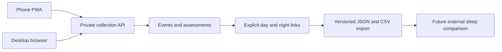

## prod_001_sommeilenor_personal_sleep_context_journal - SommeilEnOr personal sleep context journal
> Date: 2026-10-20
> Status: Proposed
> Related request: `req_000_sommeilenor_collection_only_pwa_mvp`
> Related backlog: `item_001_define_tracking_days_nights_and_collection_data_contracts`, `item_002_build_authenticated_cross_device_pwa_foundation`, `item_003_collect_repeated_beverages_physical_activities_and_naps`, `item_004_collect_meal_night_context_and_daily_assessments`, `item_005_deliver_day_night_history_and_portable_exports`, `item_006_package_and_verify_collection_mvp_for_self_hosting`
> Related task: `task_001_orchestrate_sommeilenor_collection_mvp_delivery`
> Related architecture: (none yet)
> Reminder: Update status, linked refs, scope, decisions, success signals, and open questions when you edit this doc.
> Indicators reviewed: 2026-10-20 15:22:13

# Overview
A fast French PWA to collect daily and nightly context and export it for later sleep analysis.

# Goals
- Fast online-only quick-action capture with reusable favorites, unrestricted corrections and isolated accounts.
- Reliable temporal links across midnight and devices.
- Complete portable records with explicit missingness.

# Non-goals
- Garmin import or synchronization.
- Correlation dashboards, causal claims or health recommendations.
- Production deployment during initial corpus creation.
- Offline writes or synchronization, reminders, manual sleep metrics, mixed-drink composition and a generic custom-factor builder.

# Scope and guardrails
- In: authenticated cross-device collection, historical editing and complete export.
- In: repeated beverages, activities, naps, meal and night context, daily stress.
- Out: Garmin integration, correlations and health recommendations.
- Repository planning does not authorize production deployment.
- Public source contains only synthetic fixtures; journal data stays private.

# Product overview

# Key product decisions
- Confirmed: open email/password registration with private per-account data; online-only quick capture; separate repeated drink intakes and reusable favorites.
- Confirmed: strict 04:00 Europe/Paris tracking-day boundary with manual night reassignment. Habitual 23:30–07:00 is informational only and never changes assignment or creates sleep measurements.
- Confirmed: green tea, black tea, mate and infusions with volume; one activity type per session with intensity, start and duration; naps start/duration.
- Confirmed: independent daily alcohol/gluten yes/no; dinner time plus small/medium/big/massive quantity; manual late-sugar yes/no plus time when present; non-caffeinated evening drink yes/no; cat presence only.
- Confirmed: separate experienced tracking-day stress and anticipated next-day stress, each absent/medium/high; planned early-wake constraint with target time and reason; unrestricted past corrections.
- Confirmed: a private free-text feature-suggestion control near every action, with an in-app suggestion list and no automatic GitHub publication. Suggestions are separate from health journal events.
- Implementation defaults explicitly documented: volume in ml; initial activity types walking/running/cycling/strength/other; intensity low/medium/high; fixed drink catalog; versioned JSON and CSV all-history export; no special travel mode.
- User delegates stack selection: React/TypeScript, FastAPI, SQLite and Docker. Public source only; no personal records or credentials. Hosting integration remains a later operational step.
- Excluded: offline writes, mandatory recap, generic custom factors, mixed-ingredient drinks, reminders, manual sleep measurements, cat awakening metrics, Garmin integration, correlation and production deployment.

# Success signals
- A user records and corrects repeated daily events on a phone without data loss.
- The same saved entries appear on another authenticated browser.
- Post-midnight events retain their real timestamps and correct editable night link.
- Complete exports preserve repeated entries, units and missingness for later joins.
- Access control, export completeness and synthetic backup/restore are verified.

# Open questions
- No blocking collection-scope question remains after the final chat confirmations.
- The initial activity labels, fixed drink catalog, ml unit and JSON/CSV formats are documented implementation defaults; revise if usage reveals a need.
- Domain/proxy configuration is a later deployment input.

# References
- Product back-reference: `req_000_sommeilenor_collection_only_pwa_mvp`
- Task back-reference: `task_001_orchestrate_sommeilenor_collection_mvp_delivery`
