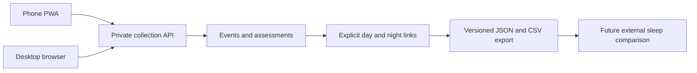

## prod_001_sommeilenor_personal_sleep_context_journal - SommeilEnOr personal sleep context journal
> Date: 2026-10-20
> Status: Proposed
> Related request: `req_000_sommeilenor_collection_only_pwa_mvp`
> Related backlog: `item_001_define_tracking_days_nights_and_collection_data_contracts`, `item_002_build_authenticated_cross_device_pwa_foundation`, `item_003_collect_repeated_beverages_physical_activities_and_naps`, `item_004_collect_meal_night_context_and_daily_assessments`, `item_005_deliver_day_night_history_and_portable_exports`, `item_006_package_and_verify_collection_mvp_for_self_hosting`
> Related task: `task_001_orchestrate_sommeilenor_collection_mvp_delivery`
> Related architecture: (none yet)
> Reminder: Update status, linked refs, scope, decisions, success signals, and open questions when you edit this doc.
> Indicators reviewed: 2026-10-20 14:10:11

# Overview
A fast French PWA to collect daily and nightly context and export it for later sleep analysis.

# Goals
- Fast online-only quick-action capture with reusable favorites and unrestricted historical correction.
- Reliable temporal links across midnight and devices.
- Complete portable records with explicit missingness.

# Non-goals
- Garmin import or synchronization.
- Correlation dashboards, causal claims or health recommendations.
- Production deployment during initial corpus creation.
- Offline writes or synchronization, reminders, manual sleep metrics, mixed-drink composition and a generic custom-factor builder.

# Scope and guardrails
- In: authenticated cross-device collection, historical editing and complete export.
- In: repeated beverages, activities, naps, meal and night context, daily stress.
- Out: Garmin integration, correlations and health recommendations.
- Repository planning does not authorize production deployment.
- Public source contains only synthetic fixtures; journal data stays private.

# Product overview

# Key product decisions
- Confirmed: online-only quick event buttons, repeated separate intakes and reusable favorites.
- Confirmed: 04:00 local day boundary, Europe/Paris initially and manual night reassignment.
- Confirmed: dinner time only, naps start/duration, distinct non-caffeinated evening context, stress absent/medium/high and planned early-wake constraints.
- Confirmed: unrestricted historical corrections, fixed factors, no reminders and no manual sleep journal.
- Stack selected under delegated user preference: React/TypeScript, FastAPI, SQLite and Docker.
- Pending only F1-F7: account policy, optional categories/fields, dietary granularity, exact stress periods, note meaning, export formats and unusual nocturnal defaults.

# Success signals
- A user records and corrects repeated daily events on a phone without data loss.
- The same saved entries appear on another authenticated browser.
- Post-midnight events retain their real timestamps and correct editable night link.
- Complete exports preserve repeated entries, units and missingness for later joins.
- Access control, export completeness and synthetic backup/restore are verified.

# Open questions
- See F1-F7 in docs/mvp-questions.md; raw answers are retained in docs/mvp-answers-round-1.md.
- Do not re-open confirmed decisions or substitute proposed defaults for unanswered follow-ups.

# References
- Product back-reference: `req_000_sommeilenor_collection_only_pwa_mvp`
- Task back-reference: `task_001_orchestrate_sommeilenor_collection_mvp_delivery`
